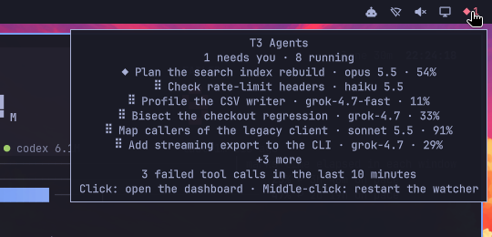

```
▀█▀ ▀▀▀▄    ▄▀▀▄ ▄▀▀▀ █▀▀▀ █▄ █ ▀█▀ ▄▀▀▀
 █   ▀▀▄    █▀▀█ █ ▀█ █▀▀  █ ▀█  █   ▀▀▄
 ▀  ▀▀▀     ▀  ▀  ▀▀▀ ▀▀▀▀ ▀  ▀  ▀  ▀▀▀
```

# T3 Agents

[](https://github.com/0xBreadguy/t3-agents/actions/workflows/test.yml)
[](LICENSE)


A live dashboard for everything your [T3 Code](https://t3.codes) agents are
doing, built to sit next to T3 and be read at a glance. Which agents are
running, which one needs you, how full each context window is, what every
subagent is up to right now, and which one has gone quiet. It comes with an
[Omarchy](https://omarchy.org) bar widget, so you see the short version without
opening anything.

> Unofficial. T3 Agents isn't made by or affiliated with the T3 Code team or
> Omarchy, and it isn't part of either. It reads T3's local database, which can
> change in any T3 update.


It's a terminal app, built on [OpenTUI](https://github.com/anomalyco/opentui).
Shape and motion carry the state: spinners while agents work, a still `◌` when
one goes quiet, one hot color for "needs you", and a subtle hue per model
provider. It follows your Omarchy theme live.

## Try it

You don't need T3 data to see it. `--demo` runs the dashboard on a made-up
workspace: a few projects, subagents across Claude, GPT and Grok, one agent
waiting on you, one gone quiet, one slow test run.

```sh
git clone https://github.com/0xBreadguy/t3-agents
cd t3-agents/dashboard && npm ci
node --experimental-ffi --disable-warning=ExperimentalWarning src/main.ts --demo
```

`--help` lists every option.

## What you get

**The dashboard**

- **Big numbers up top:** active agents, agents waiting on you (the tile
  blinks), tool calls per minute, peak context, tokens today, failed calls.
- **Limits:** a meter per subscription window from Omarchy's usage records,
  with a tick for how much of the window has passed, so you can tell when
  you're burning ahead of pace.
- **Every agent and subagent as a tree:** status, a context meter that warms
  past 75% and goes hot past 90%, what it's doing right now, model, age, and an
  activity lane on a shared time axis.
- **Stall detection:** a running agent with no tool call in flight and nothing
  new for 2 minutes stops spinning and says `◌ quiet 4m · last ❯ npm test`; it
  turns warm after 8. A tool call shows its running time, and turns warm past 5
  minutes. An agent waiting on its own subagents is delegating, not stuck.
- **Linked to T3, both ways:** open a thread in T3 and the dashboard selects it
  and marks it and its subagents. Press `Enter` on any agent and T3 jumps to
  that thread.
- **Details for the selected agent:** context as a big number, its growth per
  turn, the last call's token mix, a prompt-cache meter that drains in real
  time, the plan's progress, tool mix, and recent activity.

**The bar widget**

- A dim `⠿` when nothing's running, a spinner and a count while agents work,
  and a `◆` with a count in the bar's alert color when one needs you.
- A `⚠` at full strength when it can't see T3: no dashboard installed yet, no
  T3 database, or a watcher that stopped. Hover says which, in plain words. It
  keeps retrying on its own, and it's never hidden, so a broken monitor never
  passes for a quiet one.
- Hover for the list with models and context, click to open the dashboard,
  middle-click to restart its watcher.



## Install

You need Node.js 26.4 or later with npm (Omarchy's `mise` Node qualifies) and
T3 Code's desktop app on the same machine.

**On Omarchy, with the bar widget:**

```sh
omarchy plugin add https://github.com/0xBreadguy/t3-agents --enable
~/.config/omarchy/plugins/0xbreadguy.t3-agents/dashboard/install.sh
```

The first line installs the bar widget from this repository. The second
installs the dashboard from that same copy: the program goes to
`~/.local/share/t3-agents/` with its pinned dependencies (`npm ci`, so it needs
the network on the first install and again whenever the lockfile changes), plus
a `t3-agents` command in `~/.local/bin` and a **T3 Agents** entry in the app
launcher. It adds no autostart, no keybindings and no window rules, and it
won't overwrite a launcher it didn't create.

Until the second step runs, the widget shows `⚠` and says the dashboard isn't
installed. It checks again every 15 seconds, so once the installer finishes
it picks the dashboard up by itself, with no shell restart.

Hide the widget while nothing runs with
`omarchy bar set 0xbreadguy.t3-agents hideWhenIdle true --json`. The `⚠` stays
visible either way.

**Dashboard only, any Linux terminal:**

```sh
git clone https://github.com/0xBreadguy/t3-agents
./t3-agents/dashboard/install.sh
```

Then run `t3-agents` in any truecolor terminal, or `t3-agents --window` for a
dedicated window: [foot](https://codeberg.org/dnkl/foot) when it's installed,
otherwise your default terminal through `xdg-terminal-exec`, otherwise
`$TERMINAL -e`. Under Hyprland, `--window` focuses the dashboard instead when
it's already open with its app id, which foot always sets and
`xdg-terminal-exec` sets when your terminal supports it.

The installer checks for Node.js and npm before it copies anything, and it
tells you if `~/.local/bin` isn't on your `PATH`. The `t3-agents` command it
writes runs the Node.js the installer checked, so the app launcher and the bar
widget work even when their `PATH` lacks your version manager's Node (mise,
nvm), and a project pinned to an older Node can't break it. If that Node goes
away, it falls back to the one on `PATH`; rerun the installer after switching.

## Use

| Key | Action |
| --- | --- |
| `↑` `↓` / `j` `k`, click, wheel | select an agent |
| `g` `G` / `Home` `End` | first / last agent |
| `Enter` / `o` | open the selected agent's thread in T3 Code |
| `Space` / `←` `→` | fold or unfold subagents (`←` on a leaf jumps to its parent) |
| `a` | only agents that are running or waiting, plus their parents |
| `f` | follow the thread open in T3 (on by default) |
| `t` | lane window: 15 min, 30 min, 1 h, 3 h |
| `J` `K` / `PgDn` `PgUp`, wheel over details | scroll the details |
| `p` / `r` | pause updates / refresh now |
| `x` | CRT effects, purely for fun |
| `?` / `h` | help and legend |
| `Esc` | close the help, or quit |
| `q` | quit |

The numpad works too: its Enter opens threads, and with Num Lock off its arrows,
Home, End and Page Up/Down act like the main keys.

| Mark | Meaning |
| --- | --- |
| `⠹` | running |
| `◆` | needs you (blinks) |
| `◌` | running, but nothing new for 2 minutes (warm after 8) |
| `✓` `✗` `⊘` | done, failed, interrupted |
| `●` | provider. On grayscale themes: plum Claude, teal GPT / Codex, blue Grok, gray other. Colorful themes use their own colors |
| `▎` and a band | the thread open in T3 and its subagents |

Options:

| Option | What it does |
| --- | --- |
| `--once` | print a plain-text snapshot and exit |
| `--status` | print the one-line JSON the bar widget reads; `--watch` prints a new line whenever it changes |
| `--window` | open the dashboard in its own terminal window, or focus it (the installed command only) |
| `--db PATH` | read T3's database from `PATH` |
| `--demo` | made-up agents and usage instead of yours |
| `--interval SECONDS` | how often the dashboard rereads T3, 0.5 or more (default 2) |
| `--help` | list the options |

By default it reads `~/.t3/userdata/statev2.sqlite`. If your T3 data lives
somewhere else, set `T3CODE_HOME` to that folder (it reads
`$T3CODE_HOME/userdata/statev2.sqlite`) or pass `--db`. When the database
isn't there, `--once` says which path it tried and what to check, and
`--status` puts a short version in its `error` field for the bar.

## How it works, and what it touches

- **T3 data:** every two seconds it opens T3's `userdata/statev2.sqlite`
  read-only (`readOnly`, `query_only`) in a short read transaction. It never
  creates, migrates or writes the database. Its queries select only the fields
  it shows, so authentication tables, secrets, prompts, subagent results,
  message bodies, tool output and reasoning text never reach it. Thread titles,
  tool names, file names and command excerpts are shown locally, with terminal
  control characters stripped.
- **Following T3:** under Hyprland it listens on Hyprland's event socket for
  the T3 Code window's title, which T3 sets to `project / thread`. It keeps only
  T3 windows' titles and never sends Hyprland a command that changes anything.
- **Opening threads:** `Enter` runs `xdg-open` with a `t3code://threads/…` link,
  built the way T3 builds its own, using the environment id T3 keeps beside its
  database. That's the only process it starts, and it only asks T3 to show a
  thread.
- **Usage limits:** read from Omarchy's agent usage records in
  `~/.local/state/omarchy/agents/usage/`, if they exist.
- **Network:** none. The bar widget runs one `t3-agents --status --watch`
  process that checks the database's modification time every two seconds, reads
  after T3 writes and every 30 seconds (so the failed-call count ages out), and
  prints only when the status changes. If that process can't start or stops,
  the widget tries again every 15 seconds.
- **The window:** `--window` opens the dashboard with the app id
  `TUI.t3-agents`. Omarchy treats `TUI.*` windows as terminal apps (Super+C
  copies instead of sending Ctrl+C, terminal opacity) and still tiles them; you
  can match the id in your own window rules.

Some limits worth knowing. Only agents in your local T3 database show up;
delegates on linked machines show the status recorded here. Context figures are
whatever the provider reports, sometimes only between turns. Stall thresholds
are judgment calls: a model can think for a while, and builds take minutes, so
read `◌` as "take a look", not "broken".

## Requirements and compatibility

- Node.js 26.4+, for OpenTUI's native core through Node's FFI (the launcher
  passes `--experimental-ffi`). `@opentui/core` 0.8.3 is pinned in the lockfile.
- T3 Code's desktop app with its v2 local database. This is an unofficial
  adapter to internal storage: a T3 update can change the tables or the window
  title format. Built against T3 Code Nightly, November 2026.
- Optional: Omarchy for the bar widget, its usage records and the live theme;
  Hyprland to follow the open T3 thread and to focus an open dashboard; foot,
  `xdg-terminal-exec` or `$TERMINAL` for `--window`.
- Tested on one Omarchy laptop (Hyprland 0.56, Node 26.13). Other setups are
  untested so far, and reports are welcome.

## Update and remove

Pulling or `omarchy plugin update` refreshes the source. To apply it, rerun the
dashboard installer and reopen the dashboard:

```sh
omarchy plugin update 0xbreadguy.t3-agents
~/.config/omarchy/plugins/0xbreadguy.t3-agents/dashboard/install.sh
```

If the bar widget still looks like the old version, run `omarchy restart shell`.

To remove everything:

```sh
omarchy plugin remove 0xbreadguy.t3-agents
rm ~/.local/bin/t3-agents "${XDG_DATA_HOME:-$HOME/.local/share}/applications/t3-agents.desktop"
rm -r "${XDG_DATA_HOME:-$HOME/.local/share}/t3-agents"
```

## Develop

```sh
cd dashboard
npm ci
npm test        # which agent did what, read-only source, CLI errors, stall detection, T3 link, palette, digits, layout, render
npm run check   # TypeScript
cd .. && node --test test/   # bar widget
```

The bar widget lives at the repository root (`manifest.json`, `Service.qml`,
`BarWidget.qml`, `Status.js`) so `omarchy plugin add` can install it straight
from git; check it with `omarchy plugin validate .`. Omarchy rejects symlinks in
a plugin folder, and `npm ci` creates some under `dashboard/node_modules`, so
validate a clean clone and never install dependencies inside an installed plugin
(the dashboard installer puts them in `~/.local/share/t3-agents`). The dashboard is in
`dashboard/src`: `source.ts` (SQLite adapter and stall detection), `focus.ts`
(the T3 link), `status.ts` (bar status), `usage.ts` (Omarchy limits), `theme.ts`
(live palette), `canvas.ts` (cell grid, meters, braille, big digits), `view.ts`
(layout and panels), `app.ts` (OpenTUI host), `demo.ts` (made-up data). It runs
TypeScript directly through Node's type stripping, with no build step.

## License

[MIT](LICENSE)
