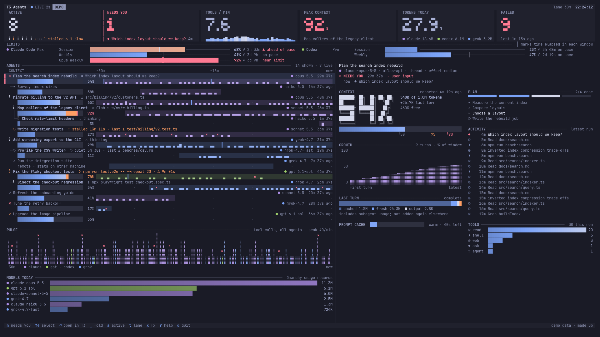
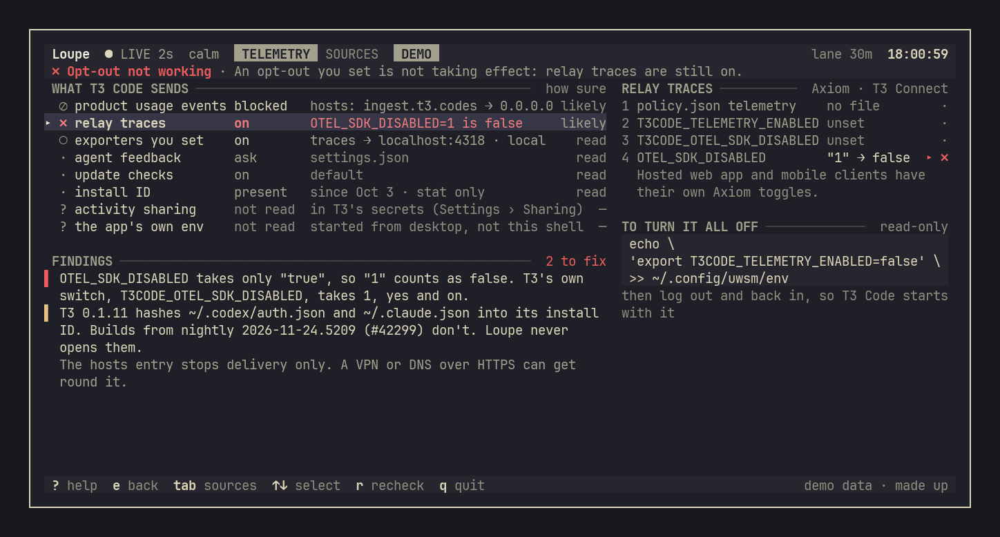
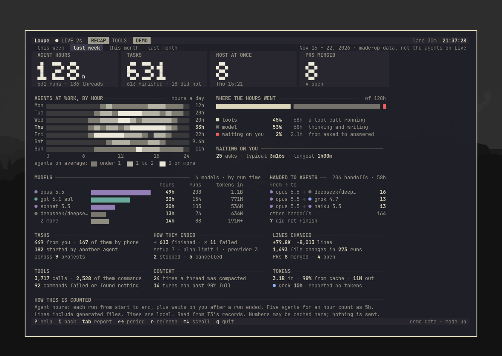
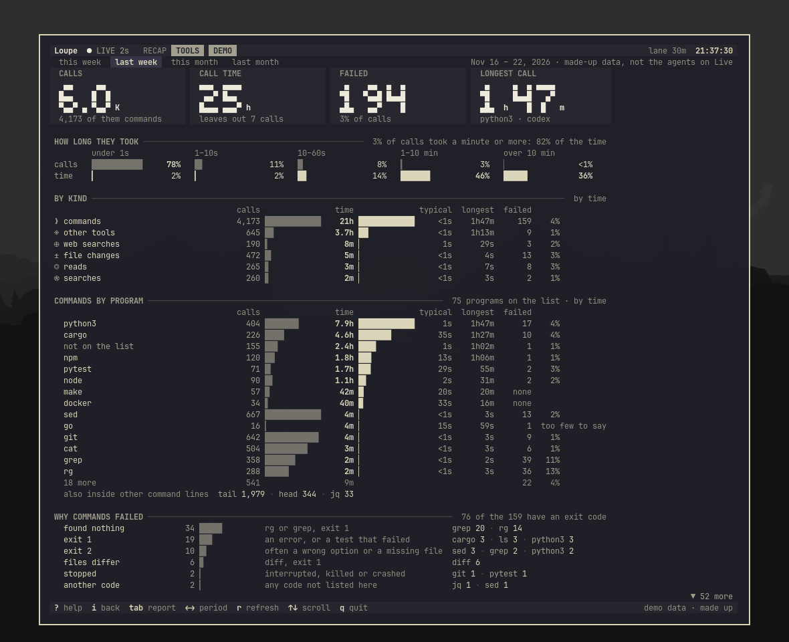
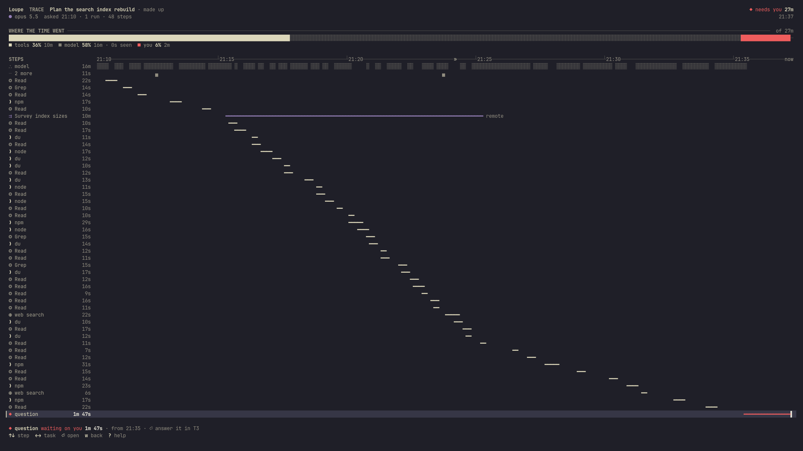
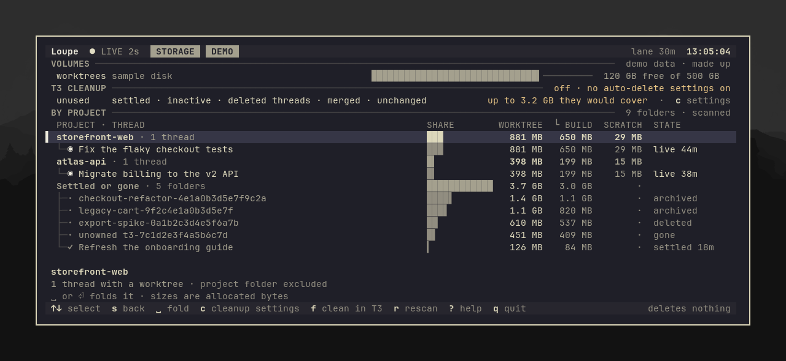

**loupe** *(n.)* — a small magnifying glass used by jewelers and watchmakers to inspect fine moving parts.

```
█    ▄▀▀▄ █  █ █▀▀▄ █▀▀▀
█    █  █ █  █ █▀▀▀ █▀▀
▀▀▀▀  ▀▀   ▀▀  ▀    ▀▀▀▀
```

# Loupe

[](https://github.com/0xBreadguy/loupe/actions/workflows/test.yml)
[](https://github.com/0xBreadguy/loupe/releases/latest)
[](LICENSE)


A live terminal dashboard for your [T3 Code](https://t3.codes) agents. It shows
who's running, who needs you, how full each context window is, and who's gone
quiet. On [Omarchy](https://omarchy.org) it also puts the short version in your
bar.

> Unofficial. Not made by or affiliated with the T3 Code team or Omarchy. It
> reads T3's local database, which can change in any T3 update.



## Where it runs

| | |
| --- | --- |
| **Linux**, x86-64 and ARM | Supported. Linux archives are built on Ubuntu 22.04. See `BUILD-INFO` for the required glibc version. |
| **macOS** 11 or later, Apple silicon and Intel | Preview. It runs, but there's no installer or menu bar item yet |
| **Windows** | Not supported |
| **Bar widget** | Omarchy only |
| **Terminals** | Anything with 256 colors or better. Checked in foot, kitty, Alacritty, Ghostty, WezTerm, VTE terminals and tmux |
| **T3 Code** | The desktop app, on the same machine |

## Install

Linux:

```sh
v=1.7.0 t=$(uname -m)-unknown-linux-gnu
curl -fLO "https://github.com/0xBreadguy/loupe/releases/download/v$v/loupe-$v-$t.tar.gz" &&
  curl -fLO "https://github.com/0xBreadguy/loupe/releases/download/v$v/SHA256SUMS" &&
  sha256sum -c --ignore-missing SHA256SUMS &&
  tar -xzf "loupe-$v-$t.tar.gz"
```

Check `loupe-$v-$t/BUILD-INFO` against `ldd --version` if you're on an older
distro, then install:

```sh
cd "loupe-$v-$t" && ./install.sh --binary ./loupe-term
```

Then run `loupe`, `loupe --telemetry-check`, or `loupe --demo` to look around
on made-up agents first.

macOS:

```sh
v=1.7.0 f=loupe-$v-universal-apple-darwin
curl -fLO "https://github.com/0xBreadguy/loupe/releases/download/v$v/$f.tar.gz" &&
  curl -fLO "https://github.com/0xBreadguy/loupe/releases/download/v$v/SHA256SUMS" &&
  shasum -a 256 -c --ignore-missing SHA256SUMS &&
  tar -xzf "$f.tar.gz" &&
  "$f/loupe-term" --demo
```

Drop `--demo` to see your own agents.

The Omarchy bar widget:

```sh
omarchy plugin add https://github.com/0xBreadguy/loupe --enable
```

Building from source, keeping the Mac build on your `PATH`, updating and
removing are all in [docs/install.md](docs/install.md).

## What you get

- **Every agent and subagent in one tree:** status, context, model, run time,
  and what it's doing right now.
- **Needs-you, one key away.** One hot color, `n` jumps to the next agent
  waiting on you, and `Enter` opens it in T3.
- **Big numbers up top:** active, waiting, tool calls a minute, peak context,
  tokens today, failed calls.
- **Stall detection.** Quiet after 2 minutes, stalled after 8, slow tool calls
  flagged.
- **Failed calls you can inspect,** with the command and the exit code.
- **Long threads stay short.** Old subagents fold into one row.
- **Three scopes:** starts on what's in T3's sidebar, or switch to everything or active only.
- **Follows T3.** On Hyprland it selects the thread you have open in T3.
- **Usage-limit meters** from Omarchy's usage records.
- **Every Omarchy theme:** all 23 built in, plus any you've installed, and it
  follows your live theme when you switch.
- **27 themes on any system,** with Dracula and three of its own. It follows
  your terminal between light and dark, `c` steps through them, and your own
  theme is one small file.
- **Calm mode,** for when you want nothing moving.
- **Insights, right in the dashboard.** Press `i` for this week's Recap,
  `Tab` for Tools, and `←` / `→` to step between periods without leaving the
  board.
- **A recap.** `loupe --recap` puts last week on one card: agent hours and
  where they went, tasks, output, and the models that did it. `--month` does
  the same for last month.
- **A tools report.** `loupe --tools` lists what agents ran last week and
  what failed, by program, with how long it all took.
- **A trace of any task.** Press `w` on an agent to see its task on a clock:
  every step, every wait on you, every delegate, live.
- **Open asks.** Each agent’s row counts requests you can answer and shows a
  separate estimate for questions in its messages.
- **Storage on Linux.** Press `s` to see disk use by project and thread. The
  dashboard warns when space is running low.
- **Telemetry check.** Press `e` in the dashboard, or run
  `loupe --telemetry-check`, to see what T3 Code sends (PostHog usage events,
  relay traces, custom OTLP exporters), whether your opt-outs are actually
  working, and the exact fix for how T3 was launched — local files only, never
  opens secrets or auth files.
- **Hand off straight to T3 Code.** Press `f` in Telemetry, Storage, Trace, or
  Insights (Tools & Recap) to open a preview popup, pick a project (or
  `"No project"`) and model, and spin up a T3 thread with Loupe's non-secret
  findings so an agent can turn telemetry off, clean up heavy worktrees,
  diagnose a slow trace, or optimize your top failing/slow commands. Press `M`
  on Live to nudge a stalled thread or queue a quick reply over SSH. Always
  asks first, never touches `--demo` or `--db`.
- **A bar widget** on Omarchy: a count in the bar, and a card of who's doing
  what when you click it.


### More views











It's one small Rust program. It only reads T3's data, never writes it, and
makes no network connections.

## Docs

- [Install, update and remove](docs/install.md)
- [Keys, marks and options](docs/usage.md)
- [Themes, and making your own](docs/themes.md)
- [Features, in detail](docs/features.md)
- [How it works, and what it touches](docs/how-it-works.md)
- [Contributing](CONTRIBUTING.md), and [notes for coding agents](AGENTS.md)

## License

[MIT](LICENSE)
