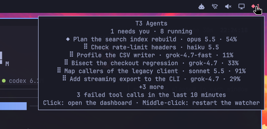

# Features, in detail

The short list is in the [README](../README.md). This is the long one.

## The dashboard

- **Big numbers up top:** active agents, agents waiting on you, tool calls per
  minute, peak context, tokens today, failed calls. Only numbers worth a look
  are big: zeros stay small and dim, and a missing value is a small `—` with the
  reason. If T3 can't be read, the tiles say so instead of showing zeros. In a
  window at least 44 rows tall and about 190 columns wide, every big number is
  drawn in a shadowed block font; smaller windows get compact half-block digits.
  One screen never mixes the two.
- **Needs you, one key away:** the tile shows what's being asked and how long
  it has waited. `n` (or a click on the tile) jumps to the next agent waiting
  on you, and `Enter` opens it in T3. Its `◆` blinks until you've seen it.
- **Limits:** a meter per subscription window from Omarchy's usage records,
  with a tick for how much of the window has passed, so you can tell when
  you're burning ahead of pace. In short windows it folds into one line with
  each provider's fullest window.
- **Every agent and subagent as a tree:** status, a context meter that warms
  past 75% and goes hot past 90%, what it's doing right now, model, how long
  its latest run took (counting up while it runs), and an activity lane on a
  shared time axis, where a failed call shows as `×`. Select an agent and the
  axis ticks the clock time its run started and ended. A new tool call sweeps
  once across the agent's name.
- **Long threads stay short:** under each agent the list keeps the subagents
  that are running, any waiting on you, and the three latest finishes from the
  last 3 hours. The rest fold into one `┄ 27 earlier ▸ · 25m–7h ago · 2 ✗`
  row, and its lane still shows their activity. Select it to see them listed in
  the details; `→`, `Enter` or a click puts them all back in the list. Top-level
  threads never fold.
- **Three ways to scope the list:** `a` steps from every unarchived thread to
  active only (running or waiting on you), then to T3's sidebar: the threads
  you haven't settled or snoozed, with their subagents. That last one keeps up
  with T3, so settling or snoozing a thread there takes it off here. Anything
  running or waiting on you stays listed in every scope, and the T3 scope also
  keeps the thread open in T3, settled or not.
- **Stall detection:** a running agent with no tool call in flight and nothing
  new for 2 minutes stops spinning and says `◌ quiet 4m · last ❯ npm test`;
  after 8 it says `◌ stalled` and turns warm. A tool call shows its running
  time, and past 5 minutes gets a `△` and turns warm. An agent waiting on its
  own subagents is delegating, not stuck.
- **Nothing hidden without a cue:** a list or panel with more than fits says
  `▼ N more`, and the list's cue sums up what's out of view (`◆1 · 1 stalled ·
  1 ✗`), turning hot when someone waiting on you is scrolled away.
- **Linked to T3, both ways:** open a thread in T3 and the dashboard selects it
  and marks it and its subagents. Press `Enter` on any agent and T3 jumps to
  that thread.
- **Details for the selected agent:** how long its latest run took and when
  (`10m 00s  14:02 → 14:12 · 31m ago`), context as a big number, its growth per
  turn, the last call's token mix, a prompt-cache meter that drains in real
  time, the plan's progress, tool mix, and recent activity. Native subagents
  also show activity when T3 records no application run for them.
- **Failures you can inspect:** recent failed calls stay at the top of the
  details, with the command or tool, age, and exit code when reported. They
  cover the selected lane window across runs, so a later run or successful
  call won't bury them. Scroll the details with `J` / `K` or the wheel;
  `Enter` opens the thread in T3 for full output. A failed call does not by
  itself mean the agent's task failed; even a search with no matches can
  return a nonzero exit code.

## The bar widget

- A dim dot cell, the dashboard's spinner at rest, when nothing's running.
  While agents work it spins on the dashboard's beat with their count before
  it; with animations off it holds one lit frame, so running never looks idle.
- A `◆` with a count in the bar's alert color when one needs you.
- An alert icon at full strength when it can't see T3: no dashboard installed
  yet, no T3 database, or a watcher that stopped. Its card says which, in
  plain words. It keeps retrying on its own, and it's never hidden, so a broken
  monitor never passes for a quiet one.
- Click for a card that lists them: the ones that need you first, in the alert
  color, then the ones running, each with its model, what it's doing and how
  much of its context it has used. `Esc` closes it; `Enter` or its button opens
  the dashboard.
- Right-click opens the dashboard straight away, middle-click restarts the
  watcher, and hovering gives a one-line summary.

